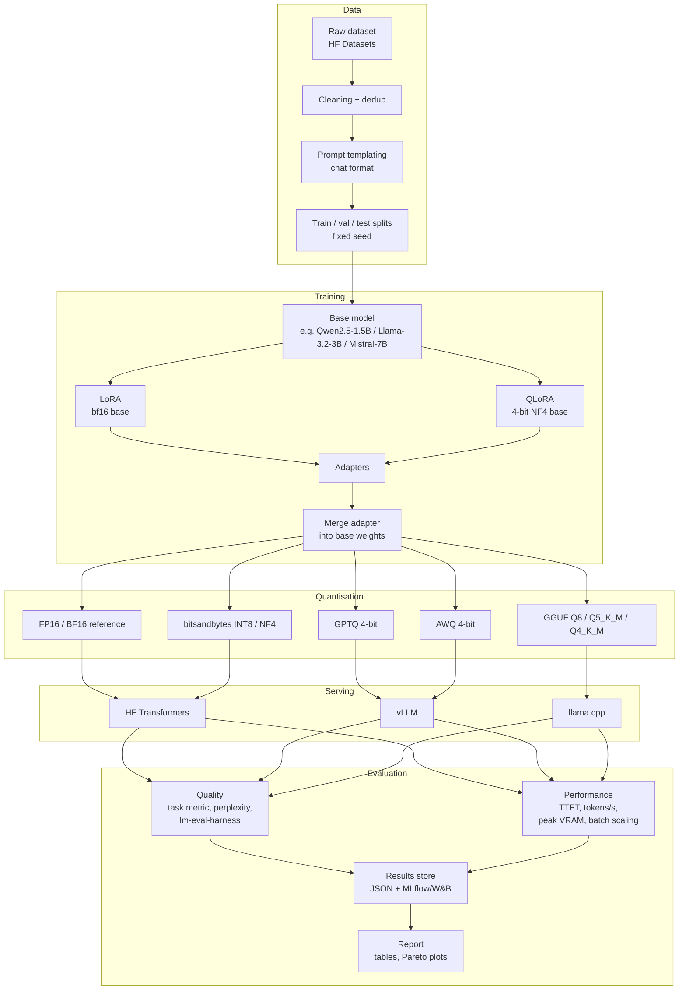

# LLM-Fine-Tuning-and-Quantisation-Benchmark
PyTorch, Hugging Face, dataset preparation, LoRA/QLoRA and inference optimisation

# LLM Fine-Tuning and Quantisation Benchmark

A reproducible benchmark that fine-tunes a small open LLM with **LoRA/QLoRA**, then measures how different **quantisation methods and inference engines** trade off quality, latency, throughput, and memory.

> **Status:** in development. Results tables are templates, to be filled from `make report`.

---

## Research questions

1. How much task quality does QLoRA recover compared with full-precision LoRA at a fraction of the memory?
2. After fine-tuning, how much quality does each quantisation method (NF4, GPTQ, AWQ, GGUF) lose, and on which task types?
3. What are the real latency, throughput, and VRAM costs of each variant on the same hardware?
4. Which configuration is the best quality-per-dollar for serving?

---

## Architecture



### Experiment matrix

| Axis | Values |
|---|---|
| Base model | 1-2 sizes (e.g. 1.5B and 7B) |
| Fine-tuning | None (base), LoRA, QLoRA |
| LoRA rank | 8, 16, 64 (ablation on one model) |
| Quantisation | FP16, INT8, NF4, GPTQ-4bit, AWQ-4bit, GGUF Q8/Q5_K_M/Q4_K_M |
| Engine | HF Transformers, vLLM, llama.cpp |
| Batch size | 1, 8, 32 |
| Seeds | 3 for training runs (report mean and std) |

Not every cell is run; the config files define the exact subset so results are reproducible.

### Design decisions

| Decision | Choice | Why |
|---|---|---|
| Task | One narrow task (e.g. structured extraction, or instruction following on a domain set) | Clear task metric, quality changes are interpretable |
| Evaluation sets | Held-out test split plus a general benchmark subset | Detects both task gains and general capability regression |
| Merge before quantising | Merge adapter, then quantise | Matches how models are deployed; GPTQ/AWQ need merged weights |
| Calibration data | Same calibration set for GPTQ/AWQ | Fair comparison between methods |
| Hardware | Fixed GPU, logged with every run | Latency numbers are only comparable on the same hardware |
| Statistics | 3 seeds, report variance | Small quality differences are often noise |

---

## Repository structure

```
llm-finetune-quant-benchmark/
├── configs/
│   ├── data/               # dataset + templating configs
│   ├── train/              # lora_r16.yaml, qlora_r16.yaml, ...
│   ├── quant/              # gptq.yaml, awq.yaml, gguf.yaml
│   └── bench/              # batch sizes, prompt lengths, engines
├── src/
│   ├── data/               # prepare.py, templates.py, splits.py
│   ├── train/              # train_lora.py (TRL SFTTrainer + PEFT)
│   ├── quantise/           # bnb.py, gptq.py, awq.py, to_gguf.py
│   ├── serve/              # hf_runner.py, vllm_runner.py, llamacpp_runner.py
│   ├── eval/               # task_eval.py, perplexity.py, lm_eval_wrapper.py
│   ├── bench/              # latency.py, throughput.py, memory.py
│   └── report/             # aggregate.py, plots.py
├── results/                # raw JSON per run (git-ignored large files)
├── notebooks/              # exploration only
├── Makefile
├── requirements.txt
└── README.md
```

---

## Tech stack

PyTorch, Hugging Face (Transformers, Datasets, PEFT, TRL, Accelerate), bitsandbytes, AutoGPTQ / GPTQModel, AutoAWQ, vLLM, llama.cpp, lm-evaluation-harness, MLflow or Weights & Biases, pandas, matplotlib.

**Hardware guide:** 1-3B models with QLoRA fit on about 8-12 GB VRAM; 7B QLoRA needs roughly 16-24 GB. Use a Colab, Kaggle, or rented cloud GPU if needed.

---

## Metrics

| Category | Metrics |
|---|---|
| Quality | Task metric (exact match / F1 / ROUGE / judge score), perplexity, lm-eval-harness subset |
| Latency | Time to first token, per-token latency, end-to-end latency (p50/p95) |
| Throughput | Tokens/second at batch sizes 1, 8, 32 |
| Memory | Peak VRAM, model size on disk |
| Cost | Estimated $ per 1M generated tokens on the benchmark GPU |
| Training | Wall-clock time, peak VRAM, trainable parameter count |

---

## Results (templates)

### Training comparison

| Method | Trainable params | Peak VRAM | Train time | Task score |
|---|---|---|---|---|
| Base (no tuning) | 0 | | | |
| LoRA r=16 | | | | |
| QLoRA r=16 | | | | |

### Quantisation and serving comparison (fine-tuned model)

| Variant | Engine | Size (GB) | VRAM (GB) | Task score | Perplexity | TTFT (ms) | Tok/s (bs=1) | Tok/s (bs=32) |
|---|---|---|---|---|---|---|---|---|
| FP16 | HF | | | | | | | |
| INT8 | HF | | | | | | | |
| NF4 | HF | | | | | | | |
| GPTQ-4bit | vLLM | | | | | | | |
| AWQ-4bit | vLLM | | | | | | | |
| Q4_K_M | llama.cpp | | | | | | | |

Plots to include: quality vs memory Pareto curve, throughput vs batch size, quality delta vs FP16 per task.

---

## Quickstart

```bash
git clone <repo-url> && cd llm-finetune-quant-benchmark
pip install -r requirements.txt

make data CONFIG=configs/data/task.yaml
make train CONFIG=configs/train/qlora_r16.yaml
make merge RUN=qlora_r16
make quantise RUN=qlora_r16 METHOD=awq
make bench RUN=qlora_r16 METHOD=awq ENGINE=vllm
make report                    # aggregates results into tables and plots
```

---

## Reproducibility

- All runs defined by YAML configs committed to the repo
- Seeds, library versions, GPU model, and git commit logged with each result
- Fixed data splits stored by hash
- Benchmark warm-up runs discarded; each latency figure is the median of N runs

## Limitations

- Results are specific to the chosen models, task, and GPU; they may not transfer
- Quantisation quality loss depends on calibration data
- vLLM and llama.cpp differ in batching and kernels, so engine and quantisation effects are partly confounded; the report separates them where possible
- Small test sets give wide confidence intervals; differences below noise are flagged

## Roadmap

- Add speculative decoding and KV-cache quantisation
- Test on a second task and model family
- Add DoRA / rsLoRA variants
- Publish adapters and quantised checkpoints to the Hugging Face Hub

## License

MIT
